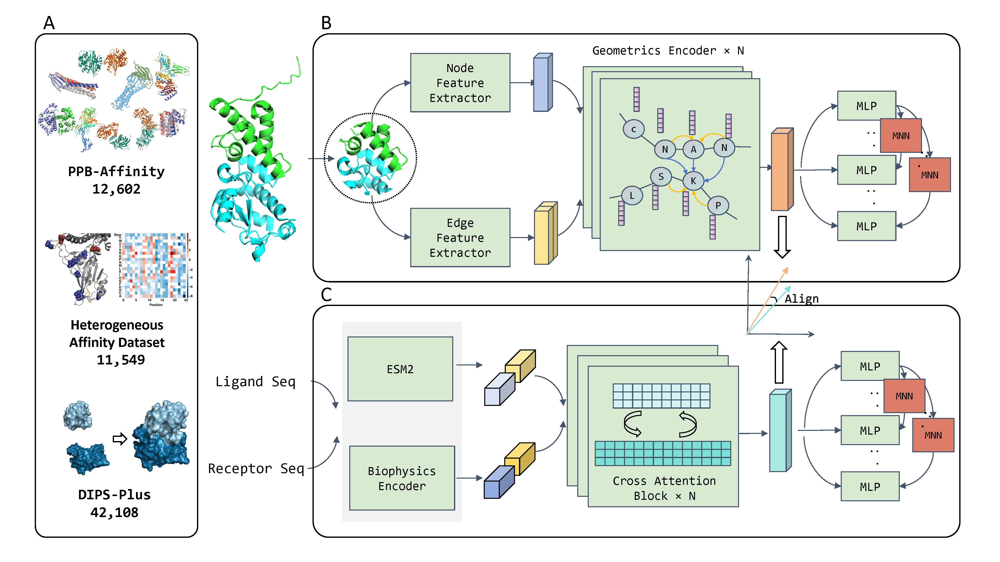

# [PPBind-3D/1D: Protein-Protein Binding Affinity Prediction for Structural and Sequence Data](https://academic.oup.com/abt/advance-article/doi/10.1093/abt/tbag053/8914384)



## 1. Prepare pre-training data

### download data

zenodo: https://zenodo.org/doi/10.5281/zenodo.11070823
rename the folder as benchmark_data

### split data

```shell
cd PPI_split
python calculate_interface_embedding.py
```

## merge data

```jupyter
run ./extra_data/integrate.ipynb
```

## 2. Train PPBind-3D

```shell
cd PPBind
# process data
python 1-0.preprocess_PPBind3D-dataset.py \
    --summary_filepath ../PPBind-3D_example_data.csv \
    --cache_dir ./cache_data/PPBind-3D_example_data/ \
    --save_dir ./cache_data/PPBind-3D_example_data/pt/
# train
python 1-1.train.py --config ./configs/train_PPBind-3D.yml --num_workers 4
```

## 3. Prepare data for fine-tuning

```
cd finetune_data_DIPS-Plus
```

### Download DIPS-Plus

```shell
wget https://zenodo.org/records/5134732/files/final_raw_dips.tar.gz
tar -xzf final_raw_dips.tar.gz
```

### Get Batch PDB Files Downloads with Shell Script

```shell
wget https://www.rcsb.org/scripts/batch_download.sh
```

### process data

```shell
python ./get_pair_chain_from_dill.py
```
    This step will generate two files:
    - DIPS-Plus-Pair-Data.csv
    - DIPS-Plus-PDB-Set.txt

### Download PDB from RCSB

```shell
mkdir ./DIPS-Plus-PDB
bash ./batch_download.sh -f ./DIPS-Plus-PDB-Set.txt -p -o ./DIPS-Plus-PDB
gunzip *.gz
```

### Merge pretrain dataset and finetune dataset

```
python ./finetune_dataset_integrate.py
```

## 4. Train PPBind-1D

```shell
cd PPBind
# process data
python 2-0.preprocess_PPBind1D-dataset.py \
    --summary_filepath ../PPBind-1D_example_data.csv \
    --cache_dir ./cache_data/PPBind-1D_example_data/ \
    --save_dir ./cache_data/PPBind-1D_example_data/pt/
# train
python 2-1.train.py --config ./configs/train_PPBind-1D.yml --num_workers 4
```

## 5. Trained Model

You can download trained weight from [Hugging Face](https://huggingface.co/ChenPy00/PPBind)

## 6. Citations

```bibtex
@article{10.1093/abt/tbag053,
    author = {Chen, Peiyi and Liu, Huaqing and Zhou, Shuxian and Wang, Lunji and Pang, Mao and Zhao, Jing and Fan, Guoxin and Han, Lanqing},
    title = {PPBind-3D/1D: Protein-Protein Binding Affinity Prediction for Structural and Sequence Data},
    journal = {Antibody Therapeutics},
    pages = {tbag053},
    year = {2026},
    month = {10},
    issn = {2516-4236},
    doi = {10.1093/abt/tbag053},
    url = {https://doi.org/10.1093/abt/tbag053},
    eprint = {https://academic.oup.com/abt/advance-article-pdf/doi/10.1093/abt/tbag053/71908208/tbag053.pdf},
}
```

<!-- #endregion -->
